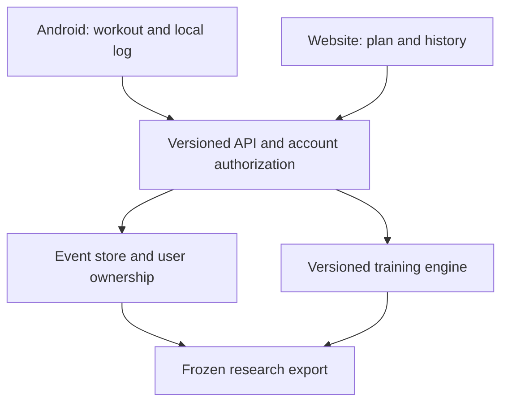

# Android + website: concrete delivery roadmap

Status after the September 2026 audit: experimental backend and technical console.
This document specifies remaining work; it is not a claim that an Android app,
public website, account system or release build has been delivered.

## Architecture decision

Retain the Python domain engine and FastAPI backend. Use one versioned API for the
website and a native Android client. Recommended Android starting point: Kotlin,
Jetpack Compose, a local Room database, repository/ViewModel separation and a
WorkManager synchronization queue. These choices follow the official
[Android architecture guide](https://developer.android.com/topic/architecture) and
[offline data guidance](https://developer.android.com/topic/architecture/data-layer/offline-first).
They are a proposal for this repository, not an existing implementation.

The server is authoritative for accepted events, model versions and synchronized
plans. Android's local database drives immediate display and draft logging while
offline. Do not copy evolving Python equations into Kotlin/JavaScript independently.
For offline use initially show the downloaded plan and simple explicit user rules;
server-dependent estimates show their timestamp and stale/unavailable state.

## Actual delivery status

| Capability | Present | Missing / acceptance gate |
|---|---|---|
| Core API and persistence | Python/FastAPI, SQLAlchemy, Alembic | Versioned API contract, migrations with real backups |
| Strength logging | Multi-lift workload and count/VBT input | Standard exercise catalogue, executed-set UI, edit/undo, full transactionality |
| Endurance | Duration, declared intensity, power and Strava | Gap quality, robust modality/threshold provenance, endurance outcome model |
| Training priorities | Strength/endurance/balanced program logic | Persist preferences and connect all program/coach/replan flows to API and UI |
| Daily state and autoregulation | Experimental heuristics | Observable outcomes, confidence/abstention, consistent policy/scale |
| Browser interface | Technical shadow console | Accessible user screens; no JSON editing in normal user tasks |
| Accounts | Single private admin key, ownership namespace | Sign-in, sessions/tokens, per-object access control, revocation/recovery |
| Android | None | Gradle project, app implementation, release signing, installable build and device QA |
| Offline sync | None | Local log, stable IDs, retries, conflicts, tombstones, process-death recovery |
| Research data | Existing synthetic artifacts and new reference demo | Consented real data, versioned forecasts/calibration, prospective protocol |

## Milestone 1 — reliable shared data and private pilot

Build an immutable event envelope: `event_id`, `athlete_id`, `performed_at_utc`,
`local_timezone`, `recorded_at_utc`, `event_type`, `payload_schema_version`,
`source`, `device_id`, `payload_hash`, `supersedes_event_id` and provenance. Keep
performed time distinct from upload time. Store reps with missing measurement
slots and units; strength/endurance sessions should have stable identities that
survive retries. One UUID with the same payload returns the original result;
one UUID with different content is a conflict. Two intentionally identical workouts
are distinct UUIDs. Corrections use versioned edits, not silent historical mutation.

Make a workout, derived snapshots and capacity updates one transaction or a
transactional outbox process. Rebuild affected future states after backdated edits
with one documented replay order. Freeze calibration/model/config identifiers with
each prediction; save predictions before observations. This also removes repeated
calibration on duplicate uploads and makes research exports auditable.

Implement accounts with server-validated identities and athlete ownership checked
on every resource, including goals, sessions, exports and Strava. The existing
admin key remains an administrative facility, never a secret embedded in the app.
Use established authentication libraries or an OIDC provider; the
[FastAPI security documentation](https://fastapi.tiangolo.com/tutorial/security/)
is implementation guidance, not a complete account or authorization service.

Acceptance: unauthorized cross-athlete requests fail; retrying uploads causes no
duplicate/adaptive side effects; offline edits reconcile; backdated import yields
the same replay result as chronological ingestion; backup restoration tested.

## Milestone 2 — usable web training flow

Implement these connected screens with bounded user choices and explicit units:

1. Onboarding: goals/priority, experience, actual available days and minutes,
   equipment, recent training and recent capacity evidence. Historical PR has its
   own date and is not a current load prescription. Unknown capacity stays unknown.
2. Today: planned session, time budget, relevant recent feedback and a short reason
   for any change. Missing readiness never looks like perfect readiness.
3. Workout: performed sets/reps/load, optional per-rep velocity, set RPE, timed rest,
   technique/pain feedback and immediate save. Support non-VBT users fully.
4. Endurance: sport, duration, perceived effort, optional sensor data, threshold
   source/date and clear distinction between actual and inferred measurements.
5. Week: actual available slots, strength/endurances priorities and a missed-session
   replanning choice. Do not silently expand frequency or time.
6. History: actual performance and load, annotations and export. Separate measured
   values from experimental model estimates. No mitochondrial/central-fatigue or
   injury-probability percentages without validation.

Acceptance: complete onboarding → plan → workout → feedback → next plan without
JSON editing; keyboard/screen reader usable; mobile-sized forms usable during a
workout; errors retain entered data; estimates and timestamps are understandable.

## Milestone 3 — native Android using the same backend

Create the Android project only after the API's event and identity contracts are
stable. Implement the same Today/Workout/Week/History screens, authenticated API
client, local database, outbox and conflict handling. Preserve unfinished workouts
across rotation, process death, loss of network and app restarts. Credentials belong
in a secure account/token design, not source code or an admin-key input for users.

Android test gates: unit tests for synchronization and conflict policies, API contract
tests, emulator/instrumented tests for core flows and permissions, physical-device
checks for offline logging and background behavior. Produce an installable internal
build with reproducible version/commit and explicit backend environment. Signing,
distribution and publishing are separate actions. No APK or Play Store submission
has been produced during this audit.

A PWA or trusted web wrapper could accelerate an intermediate release, but does
not solve missing account isolation, offline transactions or unreliable model output.
Choose that only for a clearly limited pilot; do not present a wrapper as completion
of the native app roadmap.

## Milestone 4 — assisted coaching and research

Run a shadow phase: forecasts are saved before outcomes, training decisions remain
explicitly user/coach reviewed. Explain changes using actual recent performance,
RPE, session constraints and symptoms. Model estimates are secondary until validated.

Suggested decision precedence:

| Input | Behavior |
|---|---|
| Pain, illness or technique failure | Ask for appropriate user/coach review; do not override with a high score |
| Long training interruption / stale capacity | Repeat onboarding/probe and start from recent tolerable workload |
| No VBT | Use performed reps, recent sets and effort; no fabricated velocity-based increase |
| Target effort exceeded / marked rep slowdown | Offer lower remaining load/volume or more rest with an explicit explanation |
| Incomplete/missing history | Show insufficient data and retain a conservative planned session |
| Priority change | Redistribute emphasis inside the user's chosen frequency and time budget |
| Missed session | Replan within remaining slots, avoid automatic catch-up volume |
| Novel model estimate | Display status/date; do not claim proven optimality |

Example product scenario (not a physiological prescription): a returning lifter
chooses two 60-minute strength slots and one optional easy endurance slot. Strength
priority must keep two strength days, base initial loads on recent performed sets,
allow fewer sets after excessive effort and preserve the optional nature of the
third slot. The application must not use historical best lifts or a default 100%
readiness to demand previous training volumes.

## Production/research separation

Keep anonymous software fixtures separate from human data. Research exports are
pseudonymized and include consent/provenance plus event, calibration and model
versions. Access, deletion and retention need an implemented policy before enrolling
users or participants. Do not send health/training logs to extra providers merely
to simplify debugging. Full vulnerability/dependency review, rate/resource limits,
secure OAuth round-trip and account ownership testing remain release gates.

The audit fixes localhost binding for development database/Redis ports and removes
persistent admin-key browser storage. Those are limited fixes, not a public-product
security certification.
